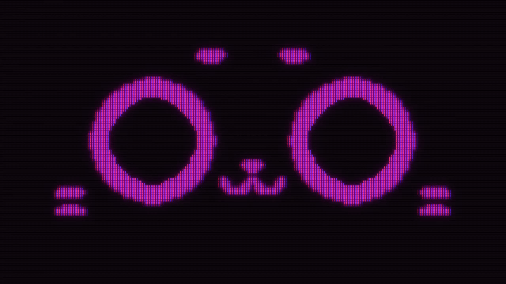

# Kerfur
[Try it in your browser](https://kerfur.kidev.org)

[](https://kerfur.kidev.org)

## Installing
Installer with updates:
- [Windows x64](https://github.com/Kidev/Kerfur/releases/latest/download/KerfurInstaller-Windows-x64.exe)
- [Linux x64](https://github.com/Kidev/Kerfur/releases/latest/download/KerfurInstaller-Linux-x64)

Application bundle for macOS:
- [macOS 15 arm64](https://github.com/Kidev/Kerfur/releases/latest/download/Kerfur-macos-15-arm64.tar.gz)

AppImage:
- [Linux x64](https://github.com/Kidev/Kerfur/releases/latest/download/Kerfur-linux-x64.AppImage)
- [Linux arm64, glibc 2.38 or newer (Raspberry Pi OS Trixie on a Pi 5)](https://github.com/Kidev/Kerfur/releases/latest/download/Kerfur-linux-arm64.AppImage)

Archive to extract:
- [Windows x64](https://github.com/Kidev/Kerfur/releases/latest/download/Kerfur-windows-x64.zip)
- [Windows arm64](https://github.com/Kidev/Kerfur/releases/latest/download/Kerfur-windows-arm64.zip)
- [Linux x64](https://github.com/Kidev/Kerfur/releases/latest/download/Kerfur-linux-x64.tar.gz)
- [Linux arm64, glibc 2.38 or newer (Raspberry Pi OS Trixie on a Pi 5)](https://github.com/Kidev/Kerfur/releases/latest/download/Kerfur-linux-arm64.tar.gz)

## Using
`Tab` shows and hides the control panel. On a touch screen or with a mouse, holding a finger or the left button on the face for five seconds does the same. `Esc` quits when the `allowEscapeShortcut` setting is on.

## Building
### Requirements
- Qt 6.12.0 or newer
- `make`, `cmake` and a C++ compiler (GCC, Clang or MSVC)
- A network connection: the build downloads `vcpkg`, and `emsdk` for the web build

### Build
Pass the Qt kit as `QT_ROOT_DIR`, version and architecture included:
```console
kidev:~$ make QT_ROOT_DIR=/opt/Qt/6.12.0/gcc_64
```

`make` alone works when `QT_ROOT_DIR` is set in the environment or exported by a `.env` file at the root of the repository.

### Make targets
- `make installer` builds an online installer that uses an FTP server as its CDN. It needs `CDN_UPLOAD_SOCKET`, `CDN_UPLOAD_USERNAME` and `CDN_UPLOAD_PASSWORD`, and uploads into a folder named after the build's OS.
- `make web` builds the WebAssembly version into `install/`.
- `make run-web` serves that build locally. Run `make web` first.
- `make upload-web` uploads the web build into a `Kerfur` folder on a web server. It needs `WASM_UPLOAD_SOCKET`, `WASM_UPLOAD_USERNAME` and `WASM_UPLOAD_PASSWORD`.
- `make models` fetches the perception models, checks each against its SHA-256, and copies them into the application data directory, which a desktop build searches first.
- `make models-pi` and `make models-web` do the same for the Raspberry Pi and web profiles. `make models-web` writes into `models/` in the source tree, and `make web` runs it and bakes the result into the WebAssembly file system.
- `make` bundles the `MODELS_PROFILE` profile (`desktop` by default, `pi` for a Pi) into `install/models`, so every archive, AppImage and installer made from that tree carries its models. `MODELS_CACHE_DIR` (`~/.cache/kidev/Kerfur/models`) keeps the verified downloads, and a rebuild copies from it.

### Web build
The page ([`web/index.html`](web/index.html)) shows the application download, the model download and the start-up as three steps, each with its own progress bar. The two downloads run in parallel, and the application compiles while it arrives.

The models are kept in the browser's IndexedDB under the SHA-256 of the data file. A later visit reads them from there, and a build with different models downloads them once and replaces the stored copy. A browser short on disk space may clear that storage, which costs one more download. Saving a person asks the browser to keep the site's storage from then on (Firefox shows a prompt for it), because people taught cannot be downloaded again. Clearing the site's data removes everything.

The build compresses every file with brotli for servers that send precompressed files. The data file is compressed once per set of models and kept in `MODELS_CACHE_DIR` under its SHA-256.

## Perception
Kerfur sees and hears with models provisioned separately from the binary, so it boots without a network. [`assets/models.json`](assets/models.json) is the manifest: it pins every file by SHA-256, and `make models` reads it. Every profile carries the same set: five vision stages, speech recognition and speaker recognition. Desktop, Pi and web run the same CPU graph through OpenCV DNN and Whisper; the profiles stay separate names so that a platform can diverge through the manifest alone.

The face, the camera preview and the microphone run without the models. The control panel names a missing model in amber beside the picture and the level meter, and keeps red for a camera or microphone that cannot capture. A stage whose model file is missing is disabled and logged at start-up.

### Camera
*Vision > Camera* chooses the camera, saved as a device id. With nothing chosen, Kerfur opens a front facing camera, otherwise the system default. When the chosen camera is unplugged, Kerfur falls back to that rule and switches back once the camera returns. A browser lists no capture modes, so a camera there delivers its own default size.

*Vision > Analysis detail* sets the longer side the camera frame is reduced to before any model runs: 960 pixels by default, up to 1920. A face across the room or a hand at arm's length is a few dozen pixels wide after that reduction, so a larger frame is what makes them detectable. The cost grows faster than the size, and the panel prints it beside the update rate in milliseconds per pass.

*Vision > Preview detail* sets the size of the picture drawn on the panel, 960 pixels on the longer side by default. The preview costs a resample and a texture upload, and the analysis costs one inference chain per frame. The panel prints the size it draws at beside the size the camera delivers.

Both sizes stop at what the camera delivers. Sizes above it are dimmed in both drop downs, and a saved choice above it shows as the camera's own size until a larger camera is chosen. A small camera resolution in the panel is the first thing to fix when detection is unreliable.

*Vision > Update rate* is how often all of this happens, and it decides what Kerfur costs to leave running. One tick takes one frame, runs every model on it once and publishes one picture: six times a second by default, which is fast enough for an expression, a grip or somebody crossing a room. The camera format is chosen to cover that rate. A webcam offering sixty frames a second would otherwise have fifty-four of them decoded, converted and discarded.

The picture is held back until the pass measured on it returns, so the boxes are drawn on the frame they were measured on.

### Knowing people
Kerfur ships with an empty gallery. Every profile carries the two models that learn a person (face recognition and speaker recognition), and people are taught from the control panel.

#### Teaching someone
In the *People* section, stage a face (*Take from camera*, or a picture file) and a voice (*Use last sentence*, or a recording), give a name, a title and a rank, and press *Save*. Each save adds what was staged to that person as one more sample. Teaching the same person again in other light, from another angle or in a noisier room makes them easier to recognise: every sample is enrolled on its own, and the closest one decides. Each person keeps up to ten pictures and ten recordings, the oldest dropped first.

Each person's row in the panel has *Teach*, which fills in their name, title and rank for the next save, *Forget faces* and *Forget voices*, which delete one kind of sample, and *Remove*. Saving a known name with nothing staged changes only the title and rank.

Both recognisers re-enrol as soon as a person is saved or changed. Everything taught is kept in `identities/` under the application data directory (`~/.local/share/kidev/Kerfur/identities` on Linux) and read back on the next start. The web build keeps that directory in the browser's IndexedDB, where it survives a reload and stays in the browser. Embeddings are cached against a hash of each file, so a new sample costs one inference and a restart costs none.

Pictures are re-encoded as PNG at most 1920 pixels on the longer side, which also drops the original's metadata. A sentence used as a voice is stored as 16 bit WAV and has to last at least two seconds; a shorter one measures the room more than the speaker, so Kerfur puts no name to it. The web build decodes a recording in any format the browser plays and stores it as WAV.

#### Rank and title
The rank decides and the title is what the interface prints. A person reads as "trusted" on screen while their rank does the deciding, and the panel spells out each decision ("owner, may command"). A record without a title shows its rank in words.

The rank decides two things. When several people are in the room, Kerfur's eyes follow the highest ranked one. An utterance acts on the world only when its voice is rank 0. Everybody is heard, transcribed, identified and shown, and when several people speak at once the higher ranked one is answered first. A command from anybody else is reported as refused, so a declined command and an unheard one look different.

#### The gallery format
The directory holds an `ids.json` and the files it names:

```json
{
    "kidev": {
        "name": "kidev",
        "faces": ["faces/kidev-1.png", "faces/kidev-2.png"],
        "voices": ["voices/kidev-1.wav"],
        "priority": 0,
        "title": "owner"
    }
}
```

- `faces`: photographs with one face each, reasonably lit
- `voices`: recordings of the person speaking alone, a few seconds each
- `priority`: the rank, zero being the top
- `title`: what the interface calls them ("owner", "trusted", anything)

Paths are relative to the manifest, so the directory copies to another machine as it is; an absolute path is left alone. Either kind of sample works alone: a person with only photographs is recognised by sight. A single `face` or `voice` string, as older manifests write, is read as the first sample of that kind.

A gallery written by hand or copied from another machine is read from the `Paths/identitiesPath` setting, unset by default. When set, that gallery is read first and the panel's records override it id by id; the panel lists and changes only its own records. A hand-written gallery may skip the manifest, in which case files are matched by stem and everybody is unranked. The panel refuses to rewrite an `ids.json` edited by hand into the list or `identities` form.

When a voice is recognised while that person's face is in shot, the camera preview draws the sentence over their head, bordered in the colour of their face box. The two are matched by name, which holds because one manifest enrols both galleries. A recognised speaker who is out of shot gets no caption; the transcript is in the hearing panel either way.

### Hands and what is in them
For a person the gallery recognises, Kerfur first locates their hands from the pose keypoints. A hand sits about a third of a forearm past the wrist, along the forearm, and measures about eight tenths of one across. An arm reaching towards the camera projects to almost no length, and a box sized from it alone would miss the hand nearest the lens, the largest one in the frame and the one most likely to hold something. So the shoulders, the trunk, the eyes and the ears are measured too, each scaled by what a hand is worth against it, and the forearm's answer is kept only where the rest of the body agrees. The result is a region to look in, where the hand pipeline starts.

That region goes to MediaPipe's two model hand pipeline: a palm detector, and a landmark model that returns twenty-one points. Both are the ONNX exports from OpenCV Zoo, so they run on the `cv::dnn` already linked, and both are pinned by SHA-256 in [`assets/models.json`](assets/models.json) like every other stage. Upstream runs the palm detector across the whole frame. Kerfur gives it the region the skeleton found, which costs less and keeps the identity rule below.

Left and right are the subject's own. The pose model labels the arms of the person it sees, and it sees a mirror, so the arm it calls left is the subject's right. Kerfur swaps them where the hands are named: a hand reported as `left` is the one that person would raise when asked to raise their left, whichever side of the mirrored preview it appears on. Skills are written against that answer.

From the twenty-one points comes a grip: zero for a flat open hand, one for a closed fist, measured as how far each fingertip sits from the wrist relative to its own knuckle, which holds across distance and rotation. Measured open hands read below 0.07 and a fist saturates at 1.0. An open hand holds nothing, so the COCO object detector skips it.

For the other hands, the object detector sees a square crop around the hand. Its input has one fixed side, so a mug thirty pixels across in a frame 960 wide shrinks to thirteen pixels in the whole frame: enough to see an object, too few to name it. In a crop the same mug arrives at a hundred and fifty pixels, which is enough to call it a cup. An object counts as held only when it overlaps the hand; a mug on the desk in front of somebody is an object in the room. Grip is the cheap filter and overlap decides, because grip tells a fist from an open palm and cannot tell a fist from a fist around a mug.

A name has to be seen twice in three looks before it is published. One pass over a small crop flickers between the two nearest classes (a cup and a bowl, a phone and a remote), and skills act on this name and Kerfur says it out loud.

The same points are counted as digits held out, from zero to five with the thumb, so a hand held up to say three reads as three and a thumbs up reads as one. The panel shows the count for every measured hand (`left 3/5`). The count is displayed and never acted on, so each digit is decided at a single line, and a hand between shapes still gets a number.

The same points are also read as a gesture: an open palm, a fist, a thumb up or down, a point, a victory, or a thumb and finger ring. Every rule is a ratio between two lengths of the same hand, so the answer holds at any distance and any rotation, and the set survives reflection: a thumb pointing up still points up in a mirror. A hand caught between two shapes reports no gesture, because a gesture gets acted on and a wrong one costs more than none.

The camera preview draws the twenty-one points as a hand skeleton over the body, with the fingertips and the wrist marked larger than the knuckles. Where the landmark model has measured a hand, its palm base replaces the pose model's wrist: both are the same joint, one guessed from a seventeen point body and one measured from a cropped hand, so the forearm ends where the hand begins. Both hand models are optional. When they are missing the forearm estimate stands alone, and the overlay draws it as a dimmed empty box. Two hands per frame get the landmark pass, chosen by rank and then by nearness (the order the eyes follow), so a room with four recognised people costs what a room with one costs.

Hands are read for recognised people only: Kerfur notices its owner holding a mug and leaves what a stranger carries alone.

### Skills
A skill is a `.qml` file in [`skills/`](skills/), read at start-up and editable without a rebuild. [`skills/calories.qml`](skills/calories.qml) uses every part:

```qml
import Skills

Skill {
    id: day
    name: "calories"

    Variable { key: "caloriesOfTheDay"; defaultValue: 0 }

    Routine {
        dailyAt: "00:00"
        onTriggered: day.set("caloriesOfTheDay", 0)
    }

    Trigger {
        intent: "when asked about adding calories"
        phrases: ["add {amount} calories", "i ate {amount} calories"]
        onFired: captures => day.add("caloriesOfTheDay", captures.amount)
    }

    Trigger {
        intent: "when asked to set the number of calories per day"
        phrases: ["set my daily calorie limit to {amount}"]
        confirm: "Are you sure you want to set the daily calorie limit to {amount}?"
        onFired: captures => day.set("maxCaloriesPerDay", captures.amount)
    }

    Trigger {
        intent: "when asked about the current calories"
        onFired: day.say("You are at <caloriesOfTheDay> of <maxCaloriesPerDay> calories")
    }

    Watch {
        key: "caloriesOfTheDay"
        onChanged: value => {
            if (value > day.number("maxCaloriesPerDay"))
                day.emitEvent("calorieLimitExceeded", { "total": value });
        }
    }
}
```

- `intent` is the request written as a sentence. It identifies the trigger, it is what a language model would be shown, and the matcher can match on it alone.
- `phrases` are the exact forms the local matcher recognises, with `{slot}` placeholders. A value becomes a number whether it was spoken as digits or as words, since Whisper writes "three hundred" as often as "300". The pattern "add {amount} calories" matches "hey kerfur could you add three hundred calories please".
- `confirm` asks before acting. The skill writes nothing until the person who was asked says yes, and only their answer counts: a second voice saying "yes" across the room is another sentence.
- `authority` is the lowest rank allowed to fire a trigger, zero by default. `Trigger.Anyone` opens it to strangers.
- `Routine` runs on the clock whether or not anybody is talking. `dailyAt` follows the wall clock and re-arms against it, so it neither drifts nor skips a midnight the machine slept through.
- `Variable` and `Watch` declare and react to shared state. Everything lives on `Blackboard`, persisted to `blackboard.json`, and QML binds to it by name:

  ```qml
  readonly property real calories: Blackboard.values.caloriesOfTheDay
  onCaloriesChanged: ...
  ```
- `emitEvent` is the only way out of the skill sandbox. A skill raises a named event on `Skills.eventRaised` and something outside acts on it, so a home automation system is reached through that event and a skill file can never stop the robot from starting.

`LanguageBackend` matches skills. Its one implementation matches phrases and descriptions locally and offline, in a microsecond. The interface is asynchronous so that a language model can become a subclass that posts the same request and emits the same resolution, with every existing skill unchanged. The panel names the backend in use.

The *Reload* button in the panel re-reads the directory, so an edited skill takes effect without a rebuild or a restart.

### Build options
- `KERFUR_PLATFORM` is `pi`, `desktop`, `wasm` or `auto`.
- `KERFUR_PERCEPTION_BACKEND` is `cpu`, `hailo`, `none` or `auto`.

The CPU backend runs on the desktop and in the browser through OpenCV DNN.
